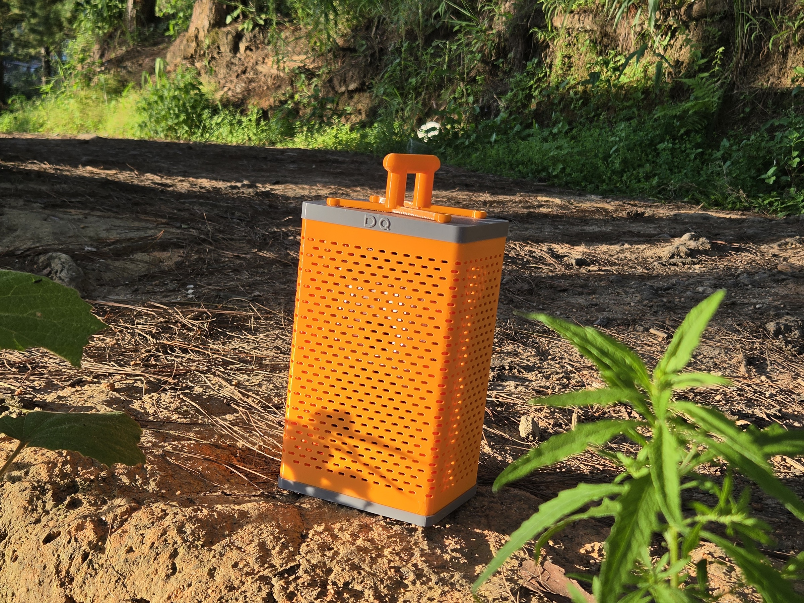

# DQ Speaker

A compact, battery-powered, two-way speaker built around a reclaimed Google
Nest Audio speaker assembly, an LF03S DSP amplifier, and a fully 3D-printed PETG
enclosure.



This repository contains the mechanical design: print-ready STL files, the
STEP assembly, the Fusion 360 build scripts and the notes used while iterating
the fit-tested prototype.

The project is currently **private for design review**. The intent is to make
it public after the files and instructions have had one final physical review.

## Why this exists

While researching tuning and other DSP products for my DQ-DSP project, I found
Google Nest Audio speaker assemblies on Shopee with the original electronics
removed. Their audio characteristics were surprisingly good, and the LF03S
board and its tuning app made them a useful platform for crossover experiments.
The result is a 135 × 99 mm rectangular enclosure whose frame carries the
speaker module, while the ventilated sleeve is trapped between the top and
bottom caps.

The design changed several times after real prints: the frame became two
halves so the speaker can actually be installed, the front mounting columns
ended at 4.2 mm, the rear bosses at 6 mm, the top cap gained an 8 mm service
pocket, and the handle became a centred V so it does not fight the power
button. Those details are already reflected in the files here.

## Current design

| Item | Specification |
| --- | --- |
| Enclosure | 135 × 99 × 224 mm, excluding handle |
| Outer sleeve | 133 × 97 × 209 mm, R7 corners, 2 mm wall |
| Caps | 135 × 99 mm, R8 corners |
| Material | Bambu Lab PETG (prototype: orange + grey) |
| Frame | Two interlocking halves, joined with four M3 fasteners |
| Front mounting columns | Six columns, 4.2 mm diameter |
| Rear mounting bosses | Four bosses, 6 mm diameter |
| Top ports | 13 mm power opening, 11 mm USB-C opening |
| Handle | Optional centred V handle using the four existing top screws |
| Printer volume | Every printed part fits within 250 × 250 × 250 mm |

The body uses no hidden glue joint. The sleeve keys into grooves in both caps;
the cap screws clamp the complete stack against the internal frame.

## Repository map

```text
cad/
  source/     Fusion 360 Python generators and the working specifications
  step/       Neutral STEP assembly
stl/          Print-ready high-refinement meshes
bom/          Bill of materials and recorded prototype cost
docs/         Printing, electronics and assembly notes
media/        Prototype, DSP and measurement photos
```

## Print one

1. Start with [the printing guide](docs/PRINTING.md).
2. Print the two frame halves first and do a dry fit against your donor module.
3. Install the heat-set inserts, then follow [the assembly guide](docs/ASSEMBLY.md).
4. Wire and test the amplifier outside the enclosure before installing the
   battery. See [the electronics notes](docs/ELECTRONICS.md).

The STL folder is the easiest route. The STEP assembly is included for edits,
and the Fusion scripts are included for anyone who wants to regenerate or
fork the parametric construction.

## What is and is not open here

The enclosure CAD, meshes, scripts and documentation in this repository are
licensed under MIT. The LF03S board firmware and its mobile DSP application
are vendor software and are **not** part of this repository. The Google Nest Audio and Sonos
names belong to their respective owners; this is an independent reuse project
and is not affiliated with or endorsed by either company.

## Prototype status

- [x] Donor speaker fit test
- [x] Two-piece frame installation test
- [x] 4.2 mm front mounting columns
- [x] 6 mm rear mounting bosses
- [x] Compact rectangular sleeve
- [x] USB-C and power access from inside the top cap
- [x] V-handle clearance and M3 × 20 fastening path
- [x] All parts verified below 250 mm on every axis
- [ ] Final public-release print of every exported STL
- [ ] Add exact slicer profiles and measured PETG consumption
- [ ] Publish the repository after review

## Contributing

Issues and pull requests are welcome once the repository is public. Please
include a photo of the donor module, the printer/material used, and the exact
part revision when reporting a fit issue. See [CONTRIBUTING.md](CONTRIBUTING.md).

## Safety

This build contains a lithium battery and a power amplifier. Use a protected
pack with a suitable BMS, verify polarity, insulate every exposed conductor,
and never charge or operate a damaged or swollen cell. The CAD is provided
without certification or warranty.

